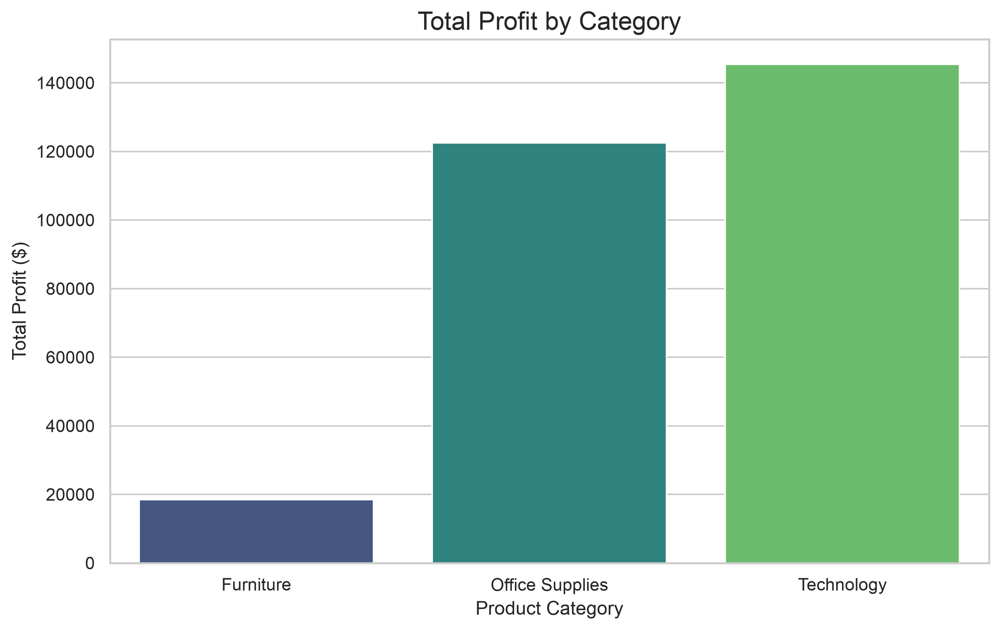
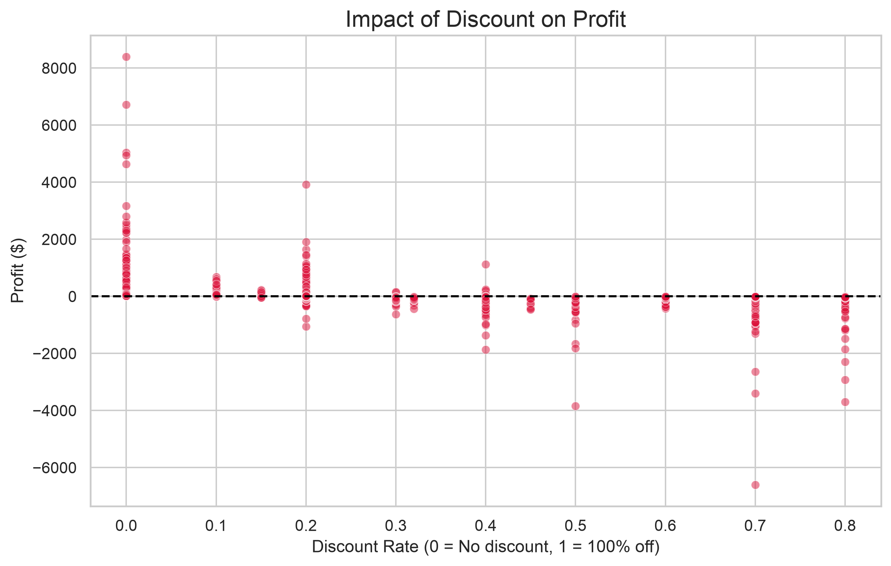

# Superstore Data Cleaning & EDA (Python)

**Tools:** Python (pandas, seaborn, matplotlib), VS Code
**Dataset:** Sample - Superstore (9,994 orders)

## Objective
To perform exploratory data analysis (EDA) on raw retail data, clean it for time-series analysis, and visually identify the factors driving profit and loss.

## Process
1. **Data Inspection:** Confirmed 9,994 rows, 21 columns, and no null values. 
2. **Data Cleaning:** Converted `Order Date` and `Ship Date` from text to datetime objects to enable time-based calculations.
3. **Feature Engineering:** Created a new column `Days to Ship` to measure fulfillment speed (median = 4 days, max = 7 days).
4. **Visualization:** 
   - Generated a bar chart proving Furniture is the lowest-profit category.
   - Generated a scatter plot proving that discounts above ~30% result in negative profit.

## Key Findings
- The dataset has no missing values, meaning any low profits are driven by business decisions (like discounts), not data errors.
- Discounts are highly correlated with losses. The scatter plot visually confirms that as the discount rate increases, profit drops below the break-even line.
- Orders are shipped quickly (median 4 days), so logistics are unlikely to be the cause of the low-profit categories.

## Visualizations

